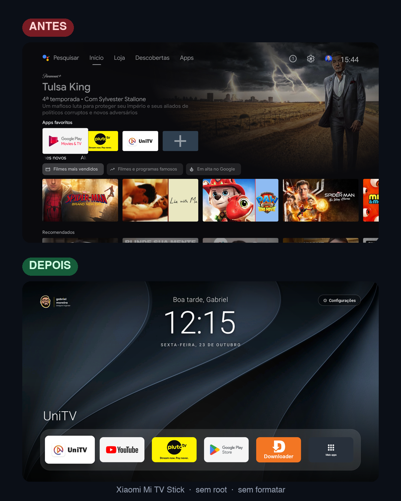

# Android TV · Customização Gabriel Tech Design

Transformei um **Xiaomi Mi TV Stick** cheio de propaganda e lento numa tela inicial limpa, no estilo
Apple TV, com a minha marca. **Sem root e sem formatar:** tudo pela rede, via ADB, e tudo reversível.



| | Antes | Depois |
|---|---|---|
| Tela inicial | Launcher do Google com banners da Apple TV, Paramount e Google Play Filmes | Launcher próprio, sem propaganda, ~15 MB de memória |
| Memória livre (de 1 GB) | ~210 MB | **~394 MB** logo após ligar |
| Botões Netflix e Prime do controle | Abriam apps de streaming pagos | Abrem **UniTV** e **YouTube** |

> A medição de memória de antes foi feita com o stick ligado há um tempo e a de depois logo após reiniciar,
> então a comparação é aproximada.

## O que este projeto faz

- **Limpeza (debloat):** remove 12 apps de fábrica (Netflix, Play Games, Play Filmes, telemetria da Xiaomi,
  motor de recomendações da home e outros), **só para o usuário**. Nada é apagado do sistema e tudo volta com
  um comando.
- **Nova tela inicial:** relógio grande centralizado, saudação ("Boa tarde, Gabriel"), papel de parede próprio,
  logo como marca d'água e um dock com os apps favoritos.
- **Menu "Mais apps":** botão no fim do dock que abre todos os apps instalados numa grade.
- **Botões do controle remapeados:** Netflix → UniTV, Prime Video → YouTube, Apps (⋮⋮⋮) → Mais apps.
- **Volta ao original quando quiser:** um script troca entre a tela customizada e a do Android TV.

O launcher é baseado no [tv-home](https://github.com/mihirgupta0900/tv-home), de Mihir Gupta (MIT), adaptado
para Android 9, traduzido para português e estendido. O original está preservado em
[`upstream-tv-home/`](upstream-tv-home/).

## Passo a passo

### 1. Prepare a TV

1. **Configurações → Preferências do dispositivo → Sobre** → aperte OK em **Build** 7 vezes.
2. Volte em **Preferências do dispositivo → Opções do desenvolvedor** → ligue **Depuração USB**.
   No Android 9 não existe "Depuração sem fio", e não precisa: com a Depuração USB ligada, o stick já aceita
   ADB pela rede na porta 5555.
3. Anote o IP: **Configurações → Rede e internet →** sua rede. O computador precisa estar no mesmo Wi-Fi.

### 2. Prepare o computador (macOS ou Linux)

Precisa de **Git** e de um **JDK 17+** (ex.: [Adoptium Temurin](https://adoptium.net/)).

```bash
git clone https://github.com/ogabrielmoreira/androidtv-claudecode.git
```

```bash
cd androidtv-claudecode
```

Baixe as ferramentas oficiais do Google (adb, build-tools 36.1 e a plataforma Android 9) para `.sdk/`.
Nada é instalado no sistema:

```bash
scripts/setup-sdk.sh
```

### 3. Conecte na TV

```bash
export TV=192.168.1.44:5555
```

```bash
scripts/connect.sh
```

Na TV aparece **"Permitir depuração USB?"**: marque **Sempre permitir** e confirme.

> **macOS:** se aparecer `No route to host` com a TV respondendo ao `ping`, é o macOS bloqueando o `adb`
> na rede local. Rode os comandos pelo app **Terminal** (e permita "Rede local" se ele pedir).

### 4. Faça a limpeza

Confira a lista antes: [`devices/xiaomi-mi-tv-stick/debloat.txt`](devices/xiaomi-mi-tv-stick/debloat.txt).
Tire dela o que você usa.

```bash
scripts/debloat.sh devices/xiaomi-mi-tv-stick/debloat.txt
```

A lista de pacotes de antes fica salva em `backup/`.

### 5. Personalize

- **Dock e apps escondidos:** [`launcher/res/values/config.xml`](launcher/res/values/config.xml)
  (nomes de pacote; descubra com `adb shell pm list packages`).
- **Saudação e textos:** [`launcher/src/com/mihir/tvhome/MainActivity.java`](launcher/src/com/mihir/tvhome/MainActivity.java)
  (procure por `"Boa tarde"`).
- **Logo:** troque [`branding/logo.png`](branding/logo.png). Para gerar a versão marca d'água a partir da sua
  logo (texto escuro vira branco): `python3 branding/make_watermark.py sua-logo.png branding/logo.png` (requer Pillow).
- **Botões do controle:** alvos em
  [`NetflixKeyActivity.java`](launcher/src/com/mihir/tvhome/NetflixKeyActivity.java) (Netflix) e
  [`RemoteButtonsService.java`](launcher/src/com/mihir/tvhome/RemoteButtonsService.java) (Prime e Apps).

### 6. Compile e instale o launcher

```bash
launcher/build.sh
```

```bash
scripts/install-launcher.sh
```

O script instala o APK, desativa (não apaga) o launcher do Google, liga o serviço **"Botões do controle"** e
aperta Home.

### 7. Logo e papéis de parede

Envie a logo e, se quiser, uma pasta com suas fotos (substituem as 12 fotos de natureza que vêm no app):

```bash
scripts/push-branding.sh ~/Pictures/wallpapers-tv
```

Fotos grandes de celular são reduzidas automaticamente. Use imagens na horizontal.

### 8. Botão Prime Video → YouTube

O sistema da Xiaomi abre o Prime Video direto quando o botão é apertado. Para o desvio funcionar, o Prime
precisa estar instalado (ele fica escondido do dock e do menu):

```bash
scripts/restore.sh com.amazon.amazonvideo.livingroom
```

A tela de abertura do Prime pode piscar por menos de 1 segundo antes do YouTube.

## Como voltar ao original

| Quero | Comando |
|---|---|
| Voltar para a tela do Android TV | `scripts/switch-interface.sh android-tv` |
| Voltar para a tela customizada | `scripts/switch-interface.sh nova` |
| Reinstalar os apps removidos | `scripts/restore.sh devices/xiaomi-mi-tv-stick/debloat.txt` |
| Tirar um print da TV | `scripts/screenshot.sh` |

Um reset de fábrica também desfaz tudo.

## Problemas que apareceram (e como foram resolvidos)

- **`No route to host` no macOS:** o macOS bloqueia o `adb` na rede local. Rodar pelo app Terminal resolve.
- **O botão Home sempre voltava para o launcher do Google:** ele é app de sistema com prioridade maior.
  A solução é desativá-lo (`pm disable-user`), não apagar.
- **"Loja", "Descobertas" e o atalho "Google Play Movies" não saem:** são fixos no launcher do Google.
  Só somem trocando o launcher.
- **O d8 do build-tools 34 quebra com o JDK 21** (`NullPointerException` em classes anônimas):
  use o build-tools 36.1, que é o que o `setup-sdk.sh` baixa.
- **Caminhos com espaço quebram o d8:** o `build.sh` compila numa pasta temporária em `/tmp`.
- **Data cortada no Android 9:** o sistema mede errado texto com `letterSpacing`. A data usa a largura toda do bloco.
- **Netflix e Prime não chegam ao serviço de acessibilidade:** a Xiaomi trata esses botões antes de qualquer app.
  O Netflix é desviado respondendo ao endereço `nflx://` que o sistema abre. O Prime é desviado quando a janela dele aparece.
  Detalhes em [`devices/xiaomi-mi-tv-stick/README.md`](devices/xiaomi-mi-tv-stick/README.md).
- **Reinstalar o launcher desliga o serviço "Botões do controle":** o `install-launcher.sh` religa.
  Manualmente: Configurações → Acessibilidade → Botões do controle.
- **Um botão "voltar para a interface do Android TV" dentro da TV** exigiria o launcher rodar comandos de sistema
  no stick (ADB local). Ficou de fora por segurança; use o `switch-interface.sh`.

## Segurança

- Quando terminar, **desligue a Depuração USB**: com ela ligada, a porta 5555 fica aberta na sua rede.
- O serviço "Botões do controle" só recebe as teclas do controle e a abertura de janelas do Prime Video.
  Ele não lê o conteúdo da tela e o launcher não acessa a internet.

## Estrutura

```text
launcher/                      tela inicial (Java puro, sem Gradle), botões do controle
  res/values/config.xml        dock, apps escondidos, colunas
  assets/wallpapers/           12 fotos (Wikimedia Commons, créditos em WALLPAPER-CREDITS.md)
scripts/                       setup do SDK, conexão, debloat/restore, instalação, branding, troca de interface
devices/xiaomi-mi-tv-stick/    lista de debloat e mapa dos botões do controle
branding/                      logo (marca d'água) e scripts das imagens
docs/                          prints de antes e depois
extras/clean-home-launcher/    primeira versão do launcher, feita do zero
upstream-tv-home/              projeto original tv-home (ferramentas em Python, exemplos, prompt)
```

## Créditos e licença

- Launcher base: [tv-home](https://github.com/mihirgupta0900/tv-home), de Mihir Gupta, licença MIT.
- Fotos de natureza: Wikimedia Commons, cada uma com sua licença, em
  [`launcher/WALLPAPER-CREDITS.md`](launcher/WALLPAPER-CREDITS.md).
- Customizações, scripts e marca: Gabriel Moreira · Gabriel Tech Design.

Código sob licença MIT, ver [LICENSE](LICENSE). A logo em `branding/` é a marca pessoal do autor e não faz
parte da licença MIT.
